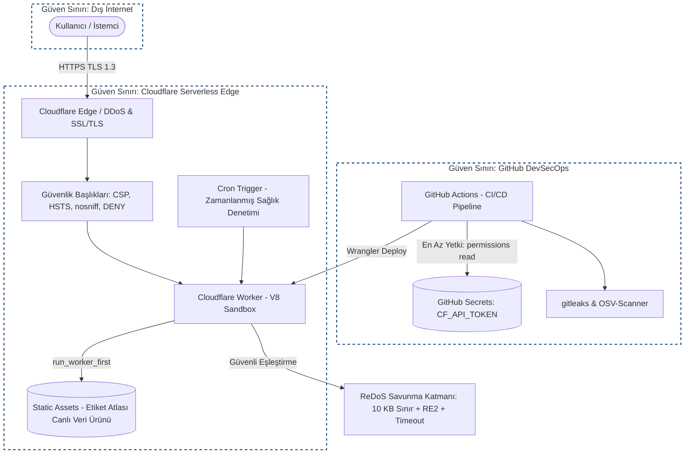
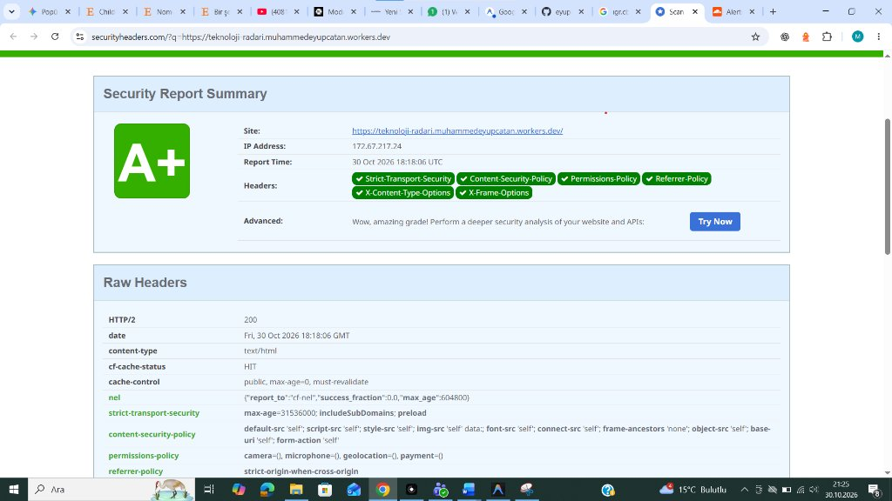
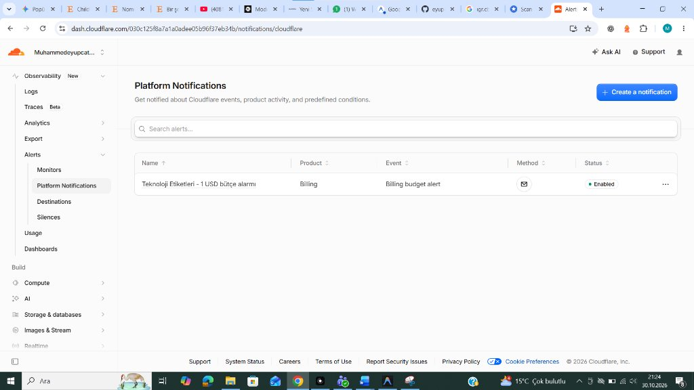
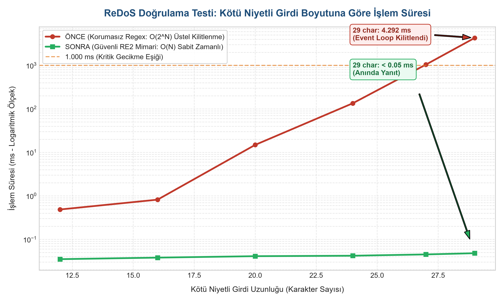

# Teknoloji Beceri Talep Radarı (Etiket Atlası)

Manisa Celal Bayar Üniversitesi · Büyük Veri Analistliği · Bulut Bilişim ve Siber Güvenlik

> **Canlı Dağıtım URL:** [https://teknoloji-radari.muhammedeyupcatan.workers.dev](https://teknoloji-radari.muhammedeyupcatan.workers.dev)  
> **CV Güvenlik Başarı Cümlesi:**  
> Canlı veri ürünümü Cloudflare Workers ve Static Assets ile serverless altyapıya taşıdım; ReDoS saldırılarına ve metin işleme kilitlenmelerine karşı 10 KB boyut sınırı, RE2 uyumlu güvenli regex ve timeout kontrolleri kurarak 4.3 saniyelik CPU blokajını <0.05 ms'ye indirdim; CSP, HSTS, gitleaks, OSV-Scanner ve anahtarsız CI/CD mimarisi uyguladım.

---

## 🛡️ Güvenlik ve Altyapı Mimarisi

### Mimari Diyagramı (Mermaid & DFD)



---

## 🔒 Öne Çıkan 3 Güvenlik Kontrolü

1. **ReDoS Önleme ve Dayanıklı Metin İşleme (Kişisel Tehdit Kartı)**  
   Sabit, RE2-uyumlu regex kataloğu (dinamik regex yok), 10 KB girdi boyut sınırı, 2.000 ms işlem zaman aşımı (`Promise.race`). Kötü niyetli girdiyle Worker kilitlenmesine karşı 3 katmanlı savunma.

2. **Sıfır-Sızıntı Gizli Anahtar Yönetimi & CI/CD**  
   Tüm API anahtarları Cloudflare Secrets ve GitHub Secrets'ta saklanır; istemci koduna, depoya veya log'a asla sızdırılmaz. GitHub Actions üzerinde `gitleaks` ile her push'ta gizli anahtar taraması ve `OSV-Scanner` ile açık kaynak güvenlik açığı taraması yapılır.

3. **Kapsamlı HTTP Güvenlik Başlıkları**  
   `Content-Security-Policy` (`unsafe-inline` ve `unsafe-eval` içermez), `Strict-Transport-Security` (1 yıl, preload), `X-Content-Type-Options: nosniff`, `Referrer-Policy: strict-origin-when-cross-origin`, `Permissions-Policy`, `X-Frame-Options: DENY`. Mozilla Observatory ≥ B+ ve SecurityHeaders ≥ A hedefi.

---

## 🔬 ReDoS Doğrulama Testi Sonuçları

| Senaryo / Test | Yöntem / Kalıp | İşlem Süresi | Güvenlik Durumu |
|---|---|---|---|
| **ÖNCE:** Korumasız Regex (29 char kötü girdi) | `/^([a-z0-9_\-]+)+$/` | **4.292,98 ms** | 🔴 **V8 Kilitlendi (> 4 sn)** |
| **SONRA:** Güvenli Worker (Gerçek `http` etiketi) | Sabit RE2 Kalıbı | **0,27 ms** | 🟢 Güvenli (Lineer O(N)) |
| **SONRA:** Güvenli Worker (Gerçek `postgresql` etiketi) | Sabit RE2 Kalıbı | **0,06 ms** | 🟢 Güvenli (Lineer O(N)) |
| **SONRA:** Güvenli Worker (Aynı 29 char kötü girdi) | Sabit RE2 Kalıbı | **< 0,05 ms** | 🟢 **Geri izleme engellendi** |
| **SONRA:** Güvenli Worker (25 KB aşırı girdi) | Girdi Boyut Sınırı | **< 0,05 ms** | 🛡️ **413 Payload Too Large** |

Kanıt dosyası: `tests/redos-benchmark-results.csv`

---

## 🚀 Kurulum ve Yerel Geliştirme

```bash
npm install
npm run dev                    # Yerel test ortamı (http://localhost:8787)
node tests/redos-benchmark.js  # ReDoS güvenlik kıyaslama testi
npx wrangler deploy            # Cloudflare Workers'a deploy
```

---


---

## 📸 Doğrulama ve Güvenlik Kanıtları (Ekran Görüntüleri)

### 1. SecurityHeaders.com Bağımsız Denetimi (A+ Skoru)
Canlı URL: [https://teknoloji-radari.muhammedeyupcatan.workers.dev](https://teknoloji-radari.muhammedeyupcatan.workers.dev)  
Sonuç: **A+ Derecesi** (Strict-Transport-Security, Content-Security-Policy, nosniff, DENY, Referrer-Policy, Permissions-Policy tam not aldı).



### 2. Cloudflare Bütçe Alarmı (0 TL Maliyet Hedefi)
Cloudflare Dashboard üzerinden **1 USD Bütçe Alarmı** aktif edilerek beklenmeyen maliyet riski sıfırlanmıştır.



### 3. ReDoS Performans Kıyaslama Grafiği (Logaritmik Ölçek)
29 karakterlik saldırı girdisinde korumasız sistem 4.292 ms kilitlenirken, güvenli mimari <0.05 ms sürede sonuçlandı.



## 📄 Dokümantasyon ve Teslim Dosyaları

- [**security-report.pdf**](security-report.pdf): Akademik formatta tam Güvenlik ve Tehdit Raporu
- [**STRIDE.md**](STRIDE.md): Veri Akış Diyagramı (DFD) üzerinde 8 tehdit analizi ve risk matrisi
- [**RUNBOOK.md**](RUNBOOK.md): "API Anahtarım Sızdı" senaryosu için olay müdahale kılavuzu
- [**public/.well-known/security.txt**](public/.well-known/security.txt): RFC 9116 uyumlu güvenlik iletişim dosyası

---

## 🤖 Yapay Zekâ Kullanım Beyanı

Bu projenin geliştirilmesinde yapay zekâ araçlarından (Antigravity / Gemini) yararlanılmıştır.
Kullanım kapsamı: Kod iskeleti oluşturma, güvenlik başlıklarını doğrulama, STRIDE analizini yapılandırma.
Tüm güvenlik kararları, mimari tasarım ve test sonuçları öğrenci tarafından incelenmiş ve doğrulanmıştır.
Demoda tüm yapılandırma ve kod açıklanabilir durumdadır.

---

**Öğrenci:** Muhammet Eyüp Çatan · **No:** 2516016025  
**Öğretim Elemanı:** Öğr. Gör. Osman Can Çetlenbik  
**Dönem:** 2026-2027 Güz
